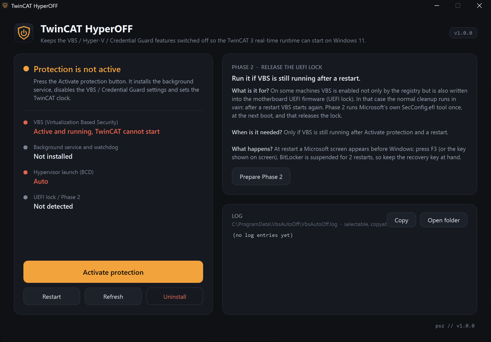
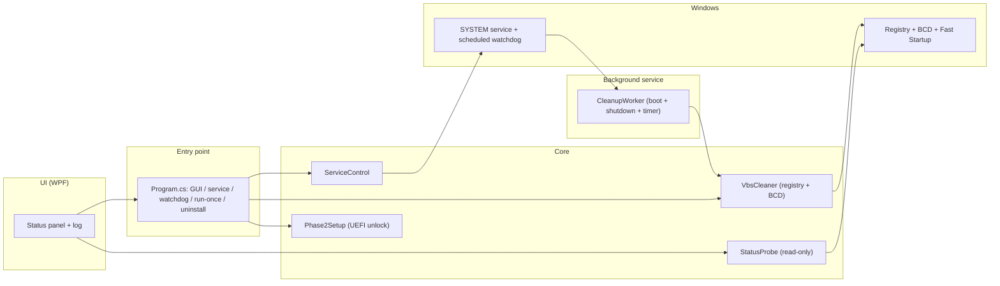

<div align="center">


# TwinCAT HyperOFF

**Keeps VBS and its friends switched off so a TwinCAT 3 real-time runtime can start on Windows 11.**


[Features](#features) · [Architecture](#architecture) · [Installation](#installation) · [Usage](#usage)

</div>

> [!WARNING]
> This program **deliberately turns off Windows virtualization-based security** (VBS, Device Guard, Credential Guard, HVCI), installs a SYSTEM-level service, and edits the registry and the boot configuration (BCD). It is only for an industrial control machine where a TwinCAT real-time runtime requires it and where you are authorized to do so. No warranty, use at your own risk.

<p align="center">
  
</p>

## The problem

The real-time part of Beckhoff TwinCAT 3 needs a layer below the kernel, but Windows virtualization-based security (VBS) puts a hypervisor exactly there, so the runtime will not start. On a managed, domain-joined Windows 11 machine a group policy (GPO) and the larger feature updates switch VBS back on again and again, so the control machine stops after the next reboot. The older manual fixes (a PowerShell script in a scheduled task) were regularly wiped out by updates.

## The solution

A tiny background service running as SYSTEM, with no scheduled task, keeps the machine clean. It runs on boot, on shutdown and on a timer, sets the VBS / Device Guard / Credential Guard / HVCI keys to 0, clears the enforcing GPO policy values, sets `hypervisorlaunchtype off` and the TwinCAT clock switches in the BCD, and turns off Fast Startup. For machines locked in UEFI it also prepares a one-time unlock step confirmed with F3 at boot. The operator sees the four status indicators on a dark WPF panel and can activate or remove the protection with one click.

## Features

- **One-click activation.** Started as admin, the "Activate protection" button installs the background service and runs the first cleanup immediately.
- **Continuous registry watch.** Every minute (more often right after boot) it sets the VBS keys to 0 and clears the enforcing GPO policy values; a featherweight operation.
- **BCD and clock.** `hypervisorlaunchtype off`, `vsmlaunchtype Off`, plus the TwinCAT real-time clock switches, written only when something actually changed.
- **Fast Startup off.** Without this, "Shut down" is really hibernation and the cleanup would not take effect on the next start.
- **Watchdog.** The service and a scheduled task rebuild each other if a Windows update removes either one.
- **UEFI-lock unlock (Phase 2).** For VBS locked in the firmware it prepares a one-time unlock with Microsoft's `SecConfig.efi`, confirmed with F3, suspending BitLocker for two reboots.
- **Transparent status.** Four indicators (VBS, service, `hypervisorlaunchtype`, UEFI lock) and the full log on the panel, copyable.
- **Clean removal.** One button deletes the service and the watchdog task.

## Architecture



The UI only drives things: the actual work happens in the `Core` layer's `VbsCleaner`, and both the manual button and the `CleanupWorker` timer call the same cleanup. `StatusProbe` only reads (registry, WMI, `bcdedit`), so the status indicators never change anything.

## Tech stack

| Layer | Technology |
|---|---|
| Language / framework | C#, .NET Framework 4.8 |
| UI | WPF (UI built from code, no compiled XAML) |
| Background process | Windows Service (`System.ServiceProcess`) |
| System access | Registry, WMI (`System.Management`), `bcdedit`, `powercfg`, `manage-bde` |
| Build | built-in `csc.exe` (`/codepage:65001`), no SDK or NuGet |

## Installation

No SDK, NuGet or admin is needed to compile: the `csc.exe` shipped with Windows does the build.

```powershell
git clone https://github.com/piszabolcs/twincat-hyperoff.git
cd twincat-hyperoff
powershell -ExecutionPolicy Bypass -File .\build.ps1
```

Output:

- `release\VbsAutoOff.exe` - the raw build (with the icon),
- `dist\TwinCAT_HyperOFF_v1.0.0_portable\` - a portable folder,
- `dist\TwinCAT_HyperOFF_v1.0.0_portable.zip` - this is what you hand out.

> The exe is unsigned, so SmartScreen / Defender may warn first: "More info" -> "Run anyway".

## Usage

1. Copy the built `TwinCAT_HyperOFF.exe` to a **local** folder (do not start it from a network drive).
2. Right click -> **Run as administrator** (UAC: Yes).
3. **"Activate protection"** -> the background service is installed and the first cleanup runs.
4. If VBS is locked in the firmware, **"Prepare Phase 2"** -> reboot -> press F3 on the Microsoft screen.
5. Restart the machine once. From then on TwinCAT starts and the machine stays clean on its own.

Check: all four indicators must be green (VBS: Off · Service: Running · `hypervisorlaunchtype`: Off · UEFI lock: None). Log: `C:\ProgramData\VbsAutoOff\VbsAutoOff.log`. Removal: the "Uninstall" button at the bottom right of the panel. Full end-user guide: [USAGE.txt](USAGE.txt).

The durable, "proper" fix from the IT side would be to exclude the Device Guard / VBS policy for these machines (OU exclusion or a WMI filter). Until then, this program keeps TwinCAT running.

## Project structure

```text
twincat-hyperoff/
├── src/VbsAutoOff/      # the full source
│   ├── Core/            # VbsCleaner, StatusProbe, Phase2Setup, ServiceControl, Proc, Logger, Elevation
│   ├── Service/         # CleanupWorker (the background service timer loop)
│   ├── Ui/              # MainWindow (WPF panel)
│   └── Program.cs       # entry point (GUI / --service / --watchdog / --run-once / --uninstall)
├── scrit/               # fallback PowerShell cleanup (regedit.ps1)
├── assets/              # icon (app.ico, app_256.png) and the icon maker script
├── build.ps1            # build with the built-in csc.exe
├── USAGE.txt            # end-user guide (also bundled into the portable package)
└── docs/                # logo, README assets
```

## Roadmap

- [ ] Signed release (code signing) so SmartScreen does not warn.
- [ ] Configurable cleanup interval on the panel.
- [ ] Export: a status and log excerpt to one file for troubleshooting.
- [ ] A short self-test that reports why a machine still shows VBS on.

## License

MIT, see [LICENSE](LICENSE).

---

<div align="center">
<sub>Built by Szabolcs Pintér · <a href="https://github.com/piszabolcs">GitHub</a> · <a href="https://www.linkedin.com/in/piszabolcs">LinkedIn</a></sub>
</div>
